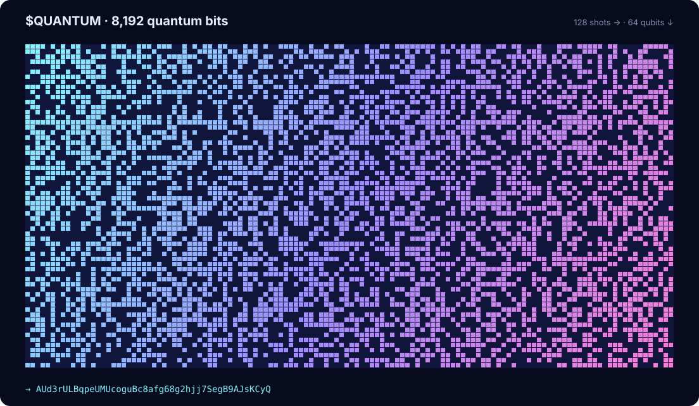
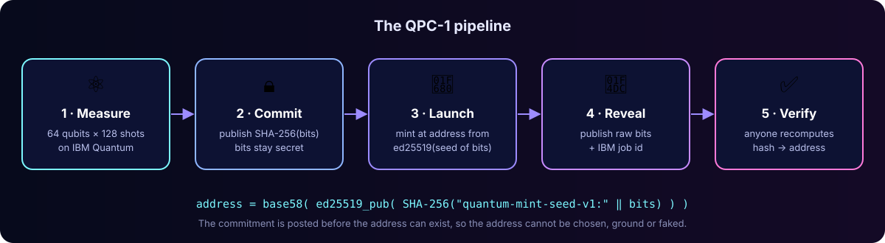
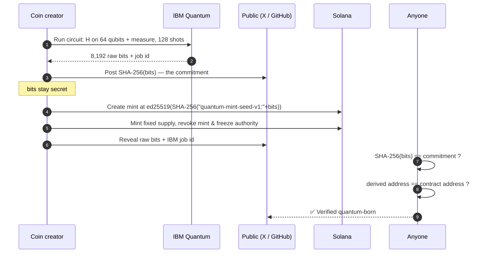
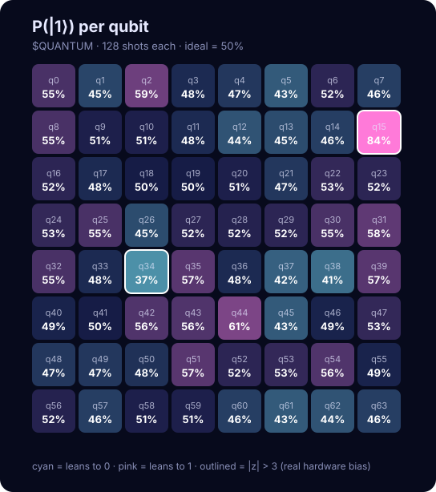

<div align="center">



<br/>

[](https://solana.com)
[](https://quantum.cloud.ibm.com)
[](https://qiskit.org)
[](https://nodejs.org)
<br/>
[](#-genesis-coin-quantum)
[](https://github.com/florianvates/quantum-protected-coin/actions/workflows/verify.yml)
[](docs/PROTOCOL.md)
[](LICENSE)
[](https://x.com/QuantumCoin_sol)

### Not a name. Not a narrative. A coin whose address was literally measured out of a quantum computer.

[**Quick start**](#-quick-start) · [**How it works**](#-how-it-works) · [**Verify $QUANTUM**](#-genesis-coin-quantum) · [**Launch your own**](#-launch-your-own-quantum-protected-coin) · [**Docs**](docs/) · [**FAQ**](#-faq)

</div>

---

## 📑 Contents

- [What is a Quantum Protected Coin?](#-what-is-a-quantum-protected-coin)
- [Genesis coin: $QUANTUM](#-genesis-coin-quantum)
- [How it works](#-how-it-works)
- [Quick start](#-quick-start)
- [Launch your own Quantum Protected Coin](#-launch-your-own-quantum-protected-coin)
- [CLI reference](#-cli-reference)
- [Coin configuration](#%EF%B8%8F-coin-configuration)
- [What “protected” means](#%EF%B8%8F-what-protected-means)
- [Randomness report](#-randomness-report)
- [QPC vs. every other “quantum” token](#-qpc-vs-every-other-quantum-token)
- [Repository layout](#-repository-layout)
- [Roadmap](#%EF%B8%8F-roadmap)
- [FAQ](#-faq)

---

## ⚛️ What is a Quantum Protected Coin?

Hundreds of tokens call themselves “quantum”. None of them have anything to do with a quantum computer.

A **Quantum Protected Coin (QPC)** is different: its on-chain address is **derived from raw qubit measurements** taken on a real IBM quantum processor, and the whole process is **cryptographically committed before launch and publicly verifiable after it**.

<table>
<tr>
<td width="33%" valign="top">

### 🎲 Born from qubits
64 qubits are put into superposition and measured 128 times. The 8,192 outcomes are true quantum randomness — nobody, including the dev, can predict or choose them.

</td>
<td width="33%" valign="top">

### 🔒 Committed first
The SHA-256 fingerprint of those bits is posted **before** the token exists. The bits can’t be swapped afterwards without breaking the hash.

</td>
<td width="33%" valign="top">

### ✅ Verifiable forever
After launch the raw bits are revealed. Anyone runs one command and gets **exactly** the contract address. Qubits in, address out.

</td>
</tr>
</table>

This repository packages that process so **anyone can mint their own Quantum Protected Coin** on Solana — and so every holder can verify one in seconds.

---

## 🧬 Genesis coin: $QUANTUM

The first coin ever born on a quantum machine, launched by [@QuantumCoin_sol](https://x.com/QuantumCoin_sol). Its data ships in [`examples/quantum/`](examples/quantum/) and is checked by CI on every commit.

| Property | Value |
|---|---|
| **Ticker** | `$QUANTUM` |
| **Chain** | Solana |
| **Contract address** | [`AUd3rULBqpeUMUcoguBc8afg68g2hjj7SegB9AJsKCyQ`](https://solscan.io/token/AUd3rULBqpeUMUcoguBc8afg68g2hjj7SegB9AJsKCyQ) |
| **Quantum computer** | IBM `ibm_marrakesh` (Heron processor) |
| **IBM job ID** | `db470m84qg6s73c1o67g` |
| **Measurement** | 64 qubits × 128 shots = **8,192 bits** |
| **Pre-launch fingerprint** | `15f22c99b64e31521c288bbb0e98ad486e71b049c6e5916c93b7270fb34711fa` |
| **Seed tag** | `quantum-mint-seed-v1:` |
| **Raw bits** | [`examples/quantum/bits.txt`](examples/quantum/bits.txt) |
| **Birth certificate** | [`examples/quantum/certificate.md`](examples/quantum/certificate.md) |
| **Status** | ✅ Fingerprint matches · ✅ Address matches |

```console
$ npm run verify:quantum

⚛  Quantum Protected Coin v1.0.0

  ✔ fingerprint  15f22c99b64e31521c288bbb0e98ad486e71b049c6e5916c93b7270fb34711fa
  ✔ address      AUd3rULBqpeUMUcoguBc8afg68g2hjj7SegB9AJsKCyQ

  VERIFIED — this coin was born from these quantum bits.
```

<div align="center">

<br/><sub>Every cell is one qubit measurement on <code>ibm_marrakesh</code>. Lit = <code>1</code>, dark = <code>0</code>. This exact picture <i>is</i> the contract address.</sub>
</div>

---

## 🔬 How it works

<div align="center">

</div>



### The math in four lines

| Step | Formula | Output |
|:-:|---|---|
| 1 | `bits = measure(H⊗64 \|0⟩) × 128` | 8,192-character string of `0`/`1` |
| 2 | `fingerprint = SHA-256(bits)` | 64-hex commitment, posted **before** launch |
| 3 | `seed = SHA-256("quantum-mint-seed-v1:" ‖ bits)` | 32-byte ed25519 seed |
| 4 | `address = base58(ed25519_pubkey(seed))` | the token’s contract address |

Full specification: [`docs/PROTOCOL.md`](docs/PROTOCOL.md).

---

## 🚀 Quick start

```bash
git clone https://github.com/florianvates/quantum-protected-coin.git
cd quantum-protected-coin
npm install

npm run verify:quantum      # verify the genesis coin
npm test                    # 12 tests, including the real $QUANTUM data
npm run demo                # dry-run launch of $QUANTUM (nothing is sent)
```

Prefer Python? Verify without Node:

```bash
pip install pynacl base58
python quantum/verify.py examples/quantum/bits.txt \
  --fingerprint 15f22c99b64e31521c288bbb0e98ad486e71b049c6e5916c93b7270fb34711fa \
  --address AUd3rULBqpeUMUcoguBc8afg68g2hjj7SegB9AJsKCyQ
```

---

## 🪙 Launch your own Quantum Protected Coin

> [!IMPORTANT]
> The order matters. **Commit → Launch → Reveal.** If you reveal the bits before your mint exists, anyone can create an account at your address first.

| # | Step | Command | Time |
|:-:|---|---|:-:|
| 1 | Get an IBM Quantum API key (free Open Plan works) | [quantum.cloud.ibm.com](https://quantum.cloud.ibm.com) | 2 min |
| 2 | Harvest 8,192 quantum bits | `python quantum/generate_bits.py` | 1–30 min (queue) |
| 3 | Check the randomness | `npx qpc analyze -b quantum/out/bits.txt` | 1 s |
| 4 | **Publish the commitment** (fingerprint only) | `npx qpc commit -b quantum/out/bits.txt --job <id> --backend <name>` | 1 s |
| 5 | Fill in your coin config | `cp config/coin.example.json my-coin.json` | 2 min |
| 6 | Rehearse on devnet | `npx qpc launch -c my-coin.json -n devnet` | 30 s |
| 7 | **Launch on mainnet** | `npx qpc launch -c my-coin.json -n mainnet-beta` | 30 s |
| 8 | **Reveal** bits + certificate | `npx qpc certificate -b quantum/out/bits.txt -c my-coin.json` | 1 s |
| 9 | Let the world verify | `npx qpc verify -b bits.txt -f <fp> -a <CA>` | 1 s |

> [!TIP]
> Testing devnet with the same bits you’ll use on mainnet is fine — devnet and mainnet are separate ledgers. Just never post the bits publicly before step 7.

Step-by-step guide with screenshots-in-words: [`docs/LAUNCH-GUIDE.md`](docs/LAUNCH-GUIDE.md).

### Using a launchpad instead?

`qpc export-keypair` writes the quantum mint keypair in Solana CLI format, so you can use it with any tool that accepts a custom mint keypair:

```bash
npx qpc export-keypair -b quantum/out/bits.txt -o quantum-mint.json
spl-token create-token quantum-mint.json          # classic SPL via Solana CLI
```

---

## 🧰 CLI reference

| Command | What it does | Key options |
|---|---|---|
| `qpc derive` | Bits → fingerprint + coin address | `-b <bits>` |
| `qpc commit` | Creates the pre-launch commitment & a ready-to-post text | `-b`, `--job`, `--backend`, `-o` |
| `qpc analyze` | NIST-style randomness checks + per-qubit bias bar | `-b`, `-q <qubits>` |
| `qpc launch` | Creates the token **at the quantum address** on Solana | `-c <config>`, `-n <network>`, `-k <wallet>`, `--dry-run` |
| `qpc certificate` | Writes a Quantum Birth Certificate (`.json` + `.md`) | `-b`, `-c`, `-o` |
| `qpc verify` | Checks bits against fingerprint and/or address | `-b`, `-f`, `-a`, `--json` |
| `qpc export-keypair` | Exports the mint keypair for other tools | `-b`, `-o` |

Use it as a library too:

```js
import { deriveKeypair, fingerprint, verify } from 'quantum-protected-coin';

const { address } = deriveKeypair(bits);
verify({ bits, expectedFingerprint, expectedAddress }).ok; // true
```

---

## ⚙️ Coin configuration

[`config/coin.example.json`](config/coin.example.json)

| Field | Type | Default | Description |
|---|---|---|---|
| `name` | string | — | Token name shown in wallets |
| `symbol` | string | — | Ticker, e.g. `QUANTUM` |
| `uri` | string | `""` | Off-chain metadata JSON (logo, description, socials) |
| `decimals` | number | `6` | Token decimals |
| `supply` | number | `1000000000` | Whole tokens minted once to your wallet |
| `bits` | path | — | Your quantum bit file |
| `expectedFingerprint` | hex | — | Launch is **refused** if bits don’t match it |
| `ibmJobId` / `backend` | string | — | Written into on-chain metadata & certificate |
| `program` | `token-2022` \| `spl` | `token-2022` | Token-2022 stores name, symbol and the quantum fingerprint **on-chain** |
| `revokeMint` | bool | `true` | Fixed supply forever |
| `revokeFreeze` | bool | `true` | No one can freeze holders |
| `revokeUpdate` | bool | `false` | Lock metadata permanently |

### On-chain metadata written by `qpc launch`

| Key | Example |
|---|---|
| `name` / `symbol` | `Quantum` / `QUANTUM` |
| `quantum_fingerprint` | `15f22c99…34711fa` |
| `quantum_seed_tag` | `quantum-mint-seed-v1` |
| `ibm_job` | `db470m84qg6s73c1o67g` |
| `quantum_backend` | `ibm_marrakesh` |

---

## 🛡️ What “protected” means

Being precise is part of being trustworthy. Here is exactly what a QPC guarantees:

| Threat | Protected? | How |
|---|:-:|---|
| Dev hand-picks or grinds a “nice” address | ✅ | Address is fixed by qubit outcomes committed in advance |
| Dev swaps the data after launch | ✅ | SHA-256 commitment posted before the mint existed |
| Fake “quantum” claim with no evidence | ✅ | Raw bits + IBM job id + one-command verification |
| Infinite mint / rug by printing | ✅ | Mint authority revoked by default |
| Wallets frozen by the dev | ✅ | No freeze authority by default |
| Revealed bits let someone control the token | ✅ | The quantum keypair is **never** an authority — it only names the address |
| Future quantum computers breaking ed25519 wallets | ⚠️ | Not solved by any token today — this is a network-level upgrade Solana is researching. See [`docs/SECURITY.md`](docs/SECURITY.md) |

In one sentence: **QPC protects the coin’s origin and supply, provably.** It is a quantum-*born* coin with a verifiable birth certificate.

---

## 📊 Randomness report

Results for `$QUANTUM` (`npx qpc analyze -b examples/quantum/bits.txt`):

| Test | Result | p-value | Status |
|---|---|:-:|:-:|
| Frequency (monobit) | 50.61 % ones (4,146 / 8,192) | 0.269 | ✅ |
| Runs | 4,107 runs (≈ 4,095 expected) | 0.798 | ✅ |
| Longest run | 17 (≈ 13 expected) | — | ✅ |
| Byte entropy | 7.782 / 8.000 bits per byte | — | ✅ |
| Per-qubit bias | 1 of 64 qubits flagged (q15) | — | ✅ |

<div align="center">

<br/><sub>Real hardware is not perfect: qubit 15 read <code>1</code> in 84 % of shots — a calibration bias you would never see in a fake “random” file. That imperfection is itself a fingerprint of physical hardware. Hashing removes the bias from the final seed.</sub>
</div>

More: [`docs/RANDOMNESS.md`](docs/RANDOMNESS.md).

---

## 🥊 QPC vs. every other “quantum” token

| | Typical “quantum” token | Vanity-address token | **Quantum Protected Coin** |
|---|:-:|:-:|:-:|
| Real quantum computer involved | ❌ | ❌ | ✅ |
| Address chosen by the dev | Random PRNG | ✅ ground on purpose | ❌ impossible |
| Pre-launch commitment | ❌ | ❌ | ✅ SHA-256 |
| Public raw data | ❌ | ❌ | ✅ 8,192 bits |
| IBM job reference published | ❌ | ❌ | ✅ |
| One-command verification | ❌ | ❌ | ✅ `qpc verify` |
| Quantum data stored on-chain | ❌ | ❌ | ✅ Token-2022 metadata |
| Supply locked by default | varies | varies | ✅ |

---

## 🗂 Repository layout

```text
quantum-protected-coin/
├── bin/qpc.js                 # command-line tool
├── src/
│   ├── core.js                # bits → fingerprint → seed → address (QPC-1)
│   ├── stats.js               # randomness health checks
│   ├── mint.js                # Solana launch (Token-2022 / SPL)
│   └── certificate.js         # Quantum Birth Certificate
├── quantum/
│   ├── generate_bits.py       # harvest bits on IBM Quantum (Qiskit)
│   ├── verify.py              # independent Python verifier
│   └── requirements.txt
├── config/coin.example.json   # template for your coin
├── examples/quantum/          # $QUANTUM genesis data + certificate
├── registry/                  # verified coins, re-checked by CI
├── scripts/                   # render-art.js (bits → SVG art), verify-registry.js
├── assets/                    # banner, diagrams, bit mosaic, heatmap
├── docs/                      # protocol, launch guide, security, randomness, FAQ
├── test/                      # node:test suite (runs real $QUANTUM data)
└── .github/                   # CI that re-verifies $QUANTUM on every push
```

---

## 🗺️ Roadmap

- [x] **QPC-1** derivation standard, compatible with `$QUANTUM`
- [x] CLI: derive · commit · analyze · launch · certificate · verify
- [x] IBM Quantum bit harvester (Qiskit Runtime, SamplerV2)
- [x] Token-2022 launch with on-chain quantum metadata & revoked authorities
- [x] Independent Python verifier
- [x] CI re-verifying the genesis coin on every commit
- [ ] Web verifier page — drop in bits, get ✅/❌ in the browser
- [x] Registry of verified Quantum Protected Coins ([`registry/`](registry/)), auto-verified by CI
- [ ] Fetch & verify bits directly from IBM job results by job id
- [ ] Support for more quantum providers (IonQ, Quantinuum, AWS Braket)
- [ ] Optional post-quantum (Winternitz) vault for treasury funds

---

## ❓ FAQ

<details>
<summary><b>Is the coin actually “made” in a quantum computer?</b></summary>

The *address* is. A quantum computer produced the 8,192 random bits; the address is a deterministic function of those bits. The Solana transaction itself is, of course, ordinary Solana.
</details>

<details>
<summary><b>Couldn’t the dev just run IBM many times and pick the best result?</b></summary>

In theory they could run several jobs, but they must publish **one** fingerprint before launch and live with whatever address it produces. Since every outcome is uniformly random, there is nothing meaningful to cherry-pick — grinding even a 4-character vanity prefix would take millions of IBM jobs, far beyond any free or paid quota.
</details>

<details>
<summary><b>The bits are public, so the mint private key is public. Is that dangerous?</b></summary>

No. The mint account already exists, so the key can’t create it again, and `qpc launch` never makes the quantum key an authority. Mint and freeze authority belong to your wallet and are revoked. The key controls nothing. Details in <a href="docs/SECURITY.md">SECURITY.md</a>.
</details>

<details>
<summary><b>Do I need to pay for IBM Quantum?</b></summary>

No — IBM’s Open Plan includes free monthly time on real 100+ qubit processors, far more than a 64-qubit × 128-shot job needs.
</details>

<details>
<summary><b>How much SOL does a launch cost?</b></summary>

About 0.007 SOL: ≈0.0049 SOL rent for the mint with on-chain metadata, ≈0.002 SOL for your token account, plus network fees. Liquidity is separate and up to you.
</details>

<details>
<summary><b>Can I verify a QPC without installing anything?</b></summary>

Any SHA-256 tool plus any ed25519 library will do — the scheme is four lines. See <a href="docs/PROTOCOL.md">PROTOCOL.md</a> for a reference implementation in plain Python.
</details>

More in [`docs/FAQ.md`](docs/FAQ.md).

---

## 🤝 Contributing

PRs welcome — especially new quantum providers, the web verifier and registry entries. Read [`CONTRIBUTING.md`](CONTRIBUTING.md) first.

## ⚠️ Disclaimer

This is open-source software for creating and verifying tokens. It is **not** financial advice and makes no claim about the value of any token. Memecoins are highly speculative; never invest more than you can afford to lose. Always do your own research.

<div align="center">

---

**Qubits in. Address out.**

<sub>Made with ⚛️ for the Solana community · Follow <a href="https://x.com/QuantumCoin_sol">@QuantumCoin_sol</a> · MIT License</sub>

</div>
